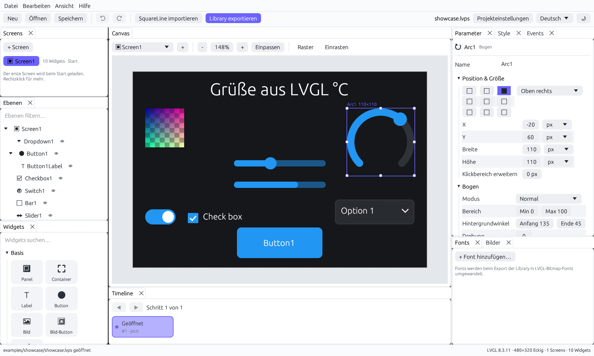
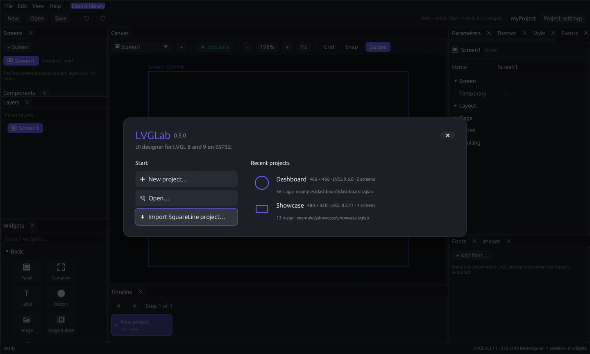
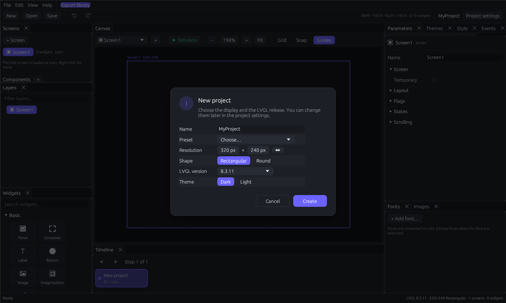
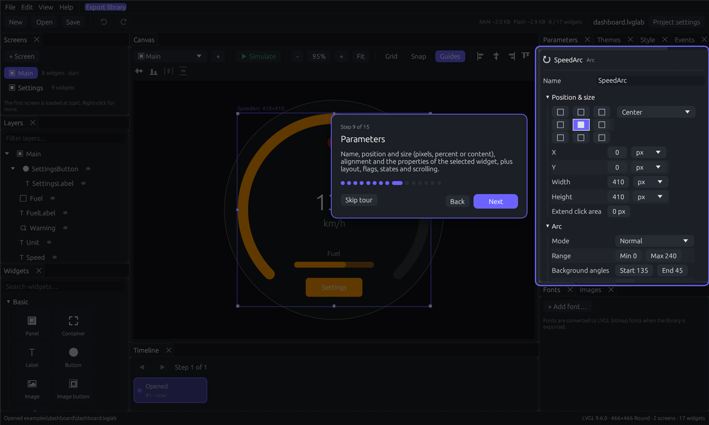
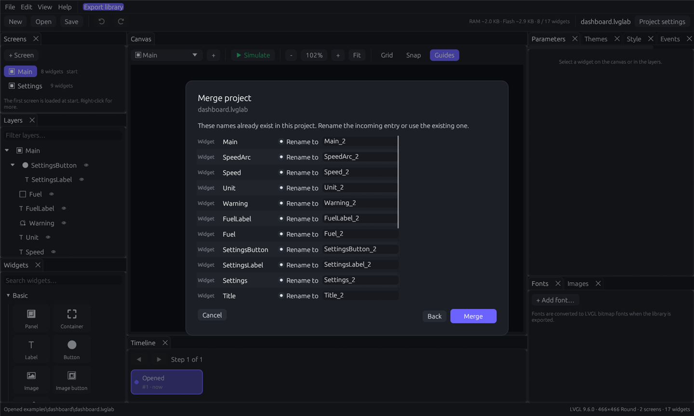

# LVGLab

[](https://github.com/bluecraank/lvglab/actions/workflows/ci.yml)
[](LICENSE)

A modern, open source UI designer for **LVGL 8 and 9** on **ESP32**, written in Rust.
Design screens visually, import existing **SquareLine Studio** projects, and LVGLab generates the
**C code** of your UI.



> LVGLab is written from scratch: the editor, the importer and the code generator are its own code,
> based on LVGL's public API. No other UI designer was reverse engineered or copied.
> LVGLab is not affiliated with LVGL LLC.

---

## Contents

- [Features](#features)
- [Screenshots](#screenshots)
- [Compatibility](#compatibility)
- [Getting started](#getting-started)
- [Working with the editor](#working-with-the-editor)
- [AI assistant](#ai-assistant)
- [Importing SquareLine Studio projects](#importing-squareline-studio-projects)
- [Exporting the UI library](#exporting-the-ui-library)
- [Using the library in a PlatformIO project](#using-the-library-in-a-platformio-project)
- [Project file format](#project-file-format)
- [Translations](#translations)
- [Architecture](#architecture)
- [Development](#development)
- [Star history](#star-history)
- [License](#license)

---

## Features

**All LVGL widgets and parameters**

- 36 widget types: every core and extra widget of LVGL 8.3. These are Panel (`lv_obj`), Container, Label,
  Button, Image, Image button, Line, Arc, Slider, Switch, Checkbox, Dropdown, Roller, Text area,
  Keyboard, Button matrix, Spinbox, Color wheel, Bar, Spinner, LED, Meter, Chart, Table, Calendar,
  Canvas, Animated image, Span group, Tab view/Tab page, Tile view/Tile, Window, List, Menu and Message box.
- The complete set of LVGL 8.3 style properties (90 properties: size, padding, background and gradients,
  background image, border, outline, shadow, text, image, line, arc, transform, flex, grid and misc).
  You can set each of them per part (main, indicator, knob, items, list of a dropdown, …) and per state
  (default, checked, pressed, focused, disabled, … and combinations).
- The same project exports for LVGL 8.3 or LVGL 9.2 – 9.6 (project settings → LVGL version); see
  [Compatibility](#compatibility) for what LVGL 9 changes.
- Object flags, initial states, scrolling (scrollbar mode, direction, snapping), extended click area,
  flex layouts.
- Events with actions: change screen (with animation), call your own C function, modify a flag or a state,
  set a text, set a value. Gestures are supported.

**Editor**

- **Start page** with the recent projects (display, LVGL version, screens, last change) and the ways to begin.
- **New project dialog**: name, display (presets, resolution, round or rectangular), LVGL version and theme.
- **Welcome tour**: 15 steps that highlight and explain the main areas; Help → Welcome tour repeats it.
- **Merge projects** (File → Merge project…): take screens of another project (or a SquareLine project) over,
  with the components, fonts, images and theme colors they use. A wizard lists every name that already
  exists; rename the incoming entry or use the existing one. References between the merged screens follow.
- **Randomizer** (🎲 in the canvas bar, Shift for all screens; Edit menu): random plausible values for arcs, bars,
  sliders, meters, LEDs, switches, check boxes, lists, charts and the numbers in labels and tables, so that
  screenshots do not show zeros everywhere. One undoable step. `--randomize` does it at startup, e.g. together
  with `--export-screenshots`.
- **Screenshots** (File → Export screenshots…): a PNG of every screen at the resolution of the display, without
  selection frames; round displays get a transparent corner. `lvglab project.lvglab --export-screenshots <folder>`
  does the same from the command line.
- **LVGL preview** (Edit → Preferences → Canvas → Preview): instead of the editor's own drawing, LVGL itself
  renders the screen. LVGLab runs the C code of the export in a small interpreter against LVGL 8.3 that is
  compiled into the program, so the canvas shows exactly what the device draws (fonts, anti-aliasing, themes,
  components, images). Selection frames work as usual. Projects for LVGL 9, the simulator and custom fonts
  still use the editor's drawing. The default stays the fast editor renderer.
- **Overview** button in the canvas bar: all screens side by side at a glance; click one to open it.
  The **Hidden** toggle next to Guides switches the orange outline of hidden widgets on and off.
- WYSIWYG canvas that approximates LVGL's default theme (dark/light, primary/secondary color), with
  round display masking, zoom, pan, grid and snapping.
- **Copy properties / Paste properties** (Edit menu, layers context menu, Ctrl+Shift+C / Ctrl+Shift+V): the properties, local styles, flags and events of a widget go to all selected widgets of the same type. Name, position, size and children stay; component instances keep their component.
- Copy and paste also work between two running LVGLab windows (the copied widget travels through a file in the temporary folder). Components, fonts, images and event targets of the source project are not copied; use *File → Merge project…* for whole screens.
- Click to select, Ctrl+click to select several. Drag to move and use the handles to resize. Arrow keys nudge by 1 px (10 px with Shift).
- Align and distribute the selection (or one widget in its parent); snap lines to the edges and centers of neighbors.
  Drag widgets from the palette onto the canvas.
- Freely dockable panels: Screens, Layers, Widgets, Parameters, Themes, Style, Events, Timeline, Fonts and Images.
  Snap them anywhere, stack them as tabs or float them as windows. The layout is remembered.
- **Timeline**: every change becomes a named step. Click any step to jump back or forward
  (Ctrl+Z / Ctrl+Y move one step). Saves and autosaves appear as highlighted green steps.
  **This screen only** lists just the steps that changed the current screen; a click restores that screen from
  the step and leaves all other screens as they are (one new step, so it can be undone).
- **Search** (Ctrl+F, Edit → Find…): finds widgets by name or type and also property values, local styles
  (colors, fonts, images, theme colors), events and flags on all screens and components. Several words
  narrow the result (`label title`, `F15C00`, `on_go`). Arrow keys and Enter or a click open the hit.
- **Autosave** of saved projects (default every 2 minutes, configurable).
- Layers with drag & drop reordering and reparenting, visibility toggle, filtering and context menu.
  Ctrl+click adds rows to the selection, Shift+click selects the range up to the clicked row, and dragging a
  selected row into a container moves the whole selection.
- Image assets (PNG/JPEG/BMP) and font assets (TTF/OTF) appear in the preview and are converted when
  you export.
- **Simulator** (F5): play the UI on the canvas. Buttons show their pressed style, switches and check
  boxes toggle, sliders and arcs follow the mouse, and the project's events run (screen changes, flags,
  states, texts, values) with their screen load animations. Taps on a tab button switch the page of a tab
  view, dragging scrolls a roller, and a keyboard types into its text area. The **Record** mode draws the pointer and every
  click for screen recordings, **⏺ GIF** records the display as an animated GIF, and **Live data** moves gauges
  and numeric labels (or shows their widest values).
- **Components**: reusable widget groups, edited like a screen and placed with the *Component* widget.
  Exported as `ui_<Name>_create()` with `ui_comp_get_child()`, `UI_COMP_<NAME>_<CHILD>` and create hooks.
- **Statistics** in the toolbar: estimated RAM and flash of the export, widgets on the current screen and in total.
- **Font check**: warns when a text uses characters its font does not contain.
- **Color themes**: named theme colors with one value per theme (e.g. Default and BmwOrange). Styles bound
  to a theme color follow `ui_theme_set()` at runtime.
- **AI assistant**: describe a screen and Claude builds it, validated against the widget catalog.
- Multi language UI (English, German, Spanish, French), light and dark appearance.
- Project settings: LVGL version, resolution (with presets), round or rectangular display.
- **Themes** tab next to the parameters: lv_theme_default (dark or light, primary and secondary color) and the color themes.

**Export**

- Clean, readable LVGL 8 or LVGL 9 C code with a flat file layout and a small API (`ui_init`,
  `ui_<Screen>_screen_init/destroy/relocalize`, `ui_img_<file>_png`, `ui_font_<name>`, `ui_theme_set`,
  `ui_object_set_themeable_style_property`, `ui____initial_actions0`).
- Configurable symbol prefix (`ui`, `sett`, …) for several UI libraries in one firmware.
- Multi-language texts with [lv_i18n](https://github.com/lvgl/lv_i18n) (`_("text")`, `ui_relocalize()`).
- LVGL 9: only the native API of the selected release, no deprecated aliases of renamed functions.
- Byte-swapped images for `LV_COLOR_16_SWAP 1` with LVGL 8 (checked at compile time).
- Images are converted to `lv_img_dsc_t` (LVGL 8) or `lv_image_dsc_t` (LVGL 9), RGB565 with an alpha
  channel when needed.
- Fonts are rendered to LVGL bitmap fonts (`lv_font_fmt_txt`, 1/2/4/8 bpp, custom Unicode ranges).
  All font and image data is `const`, so it stays in flash.
- The export only rewrites generated files. It never touches your own code and removes stale generated
  files, for example of deleted screens.

## Screenshots

| Start page | New project |
|---|---|
|  |  |
| **Welcome tour** | **Merge projects** |
|  |  |

## Compatibility

| Component | Supported |
|---|---|
| Generated code | **LVGL 8.3.x** (8.3.0 – 8.3.11) and **LVGL 9.2 – 9.6**, chosen in the project settings. Every release is verified by compiling an export with every widget type (`-Wall -Wextra -Werror`; for LVGL 9 without the aliases of renamed functions). |
| LVGL 9 differences | LVGL 9 has no meter and no color wheel: a meter is exported as `lv_scale` with a needle line, a color wheel as an empty object. Chart zoom and axis ticks, the styles `anim_speed` and `bg_dither_mode` and the blend mode *Replace* do not exist in LVGL 9 and are skipped. The export lists every change. While LVGL 9 is selected the editor hides the color wheel and these settings, and switching a project to LVGL 9 removes them (undo restores them). The canvas shows the look of the selected release. LVGL 9.6 marks `lv_list`, `lv_menu`, `lv_win` and `lv_obj_add_flag` as deprecated; the code builds with deprecation warnings. |
| Target | ESP32 family (ESP32, S2, S3, C3). The generated UI code is platform independent and works with any display driver. |
| Color depth | Images are RGB565. LVGL 8 needs `LV_COLOR_DEPTH 16`; LVGL 9 converts images while drawing. |
| SquareLine Studio import | `.spj` projects of SquareLine Studio 1.x (tested with editor 1.6.2 / LVGL 8.3.11). Projects for an LVGL 9 release LVGLab does not list (e.g. 9.1) target the nearest supported one. |
| Editor platforms | Windows, Linux and macOS (anything [eframe](https://github.com/emilk/egui) supports). |

## Getting started

### Download

Ready-made builds are on the [releases page](https://github.com/bluecraank/lvglab/releases):

- **Windows:** `LVGLab-<version>-windows-x64-setup.exe` installs LVGLab with a Start menu entry, an optional
  desktop icon and the `.lvglab` file association (for all users, or for the current user without
  administrator rights). It can be removed under *Settings → Apps*. The `.zip` is a portable version.
- **Linux / macOS:** unpack the `.tar.gz` and start `lvglab`.

### Build from source

Requirements: [Rust](https://rustup.rs) 1.85 or newer and a C compiler (the LVGL preview compiles LVGL 8.3).

```sh
git clone https://github.com/bluecraank/lvglab
cd lvglab
cargo run --release
```

Platform notes:

- **Windows (MSVC toolchain)**: install the "Desktop development with C++" workload of the
  Visual Studio Build Tools. This is the default rustup setup.
- **Windows (GNU toolchain)**: the Windows API crates need `dlltool`. Put the `bin` folder of a
  MinGW-w64 distribution (for example [WinLibs](https://winlibs.com)) on your `PATH`.
- **Linux**: install the development packages for GTK 3 (file dialogs) and X11/Wayland, e.g. on Debian/Ubuntu:
  `sudo apt install libgtk-3-dev libxkbcommon-dev libwayland-dev libxcb-render0-dev libxcb-shape0-dev libxcb-xfixes0-dev`

### Command line

```text
lvglab [project.lvglab | squareline.spj] [--select <widget>] [--dialog <name>] [--simulate] [--screenshot <out.png>] [--export-screenshots <folder>] [--randomize]
```

| Option | Meaning |
|---|---|
| `project.lvglab` / `file.spj` | Opens a studio project, or imports a SquareLine project. |
| `--select <widget>` | Selects a widget by name after opening. |
| `--simulate` | Starts the simulator with the record overlay. |
| `--dialog <name>` | Opens `start`, `new`, `preferences`, `about`, `discard`, `close`, the welcome tour (`tour`, `tour:<step>`) or the merge wizard (`merge:<file>`, `merge-conflicts:<file>`) at start (documentation). |
| `--screenshot <out.png>` | Renders the window into a PNG and exits (documentation, CI). |
| `--export-screenshots <folder>` | Saves a PNG of every screen of the project into the folder and exits. |
| `--randomize` | Gives all widgets random values after opening, e.g. for the screenshots. |

Started without a project, LVGLab shows the start page (unless *Open the last project on start* is enabled
in the preferences). The environment variable `LVGLAB_DATA_DIR` keeps settings and the panel layout in
another folder, e.g. for screenshots with a clean setup.

Try the bundled examples: `cargo run --release -- examples/dashboard/dashboard.lvglab` (round display,
LVGL 9) or `examples/showcase/showcase.lvglab`.

## Working with the editor

On the first start a welcome tour explains the main areas in 15 steps; **Help → Welcome tour** repeats it.

| Panel | Purpose |
|---|---|
| **Canvas** | Preview of the current screen. Click to select, drag to move, use the handles to resize. Ctrl + mouse wheel zooms, the wheel or the middle mouse button pans. **▶ Simulate** (F5) plays the UI; **Record** shows pointer and clicks; **↺** restarts with the current project. |
| **Screens** | All screens. The first one is loaded at start. Right-click to reorder, duplicate or delete. |
| **Layers** | Widget tree of the current screen. Drag rows to reorder or reparent. The eye toggles the hidden flag. |
| **Widgets** | Palette grouped into Basic, Controls, Visualization and Containers. Click to add to the selection, or drag onto the canvas. |
| **Parameters** | Name, position & size (px, %, content), alignment, widget properties, flex layout, flags, states, scrolling. |
| **Themes** | LVGL's default theme (dark or light, primary and secondary color) and the color themes. |
| **Style** | Local styles per part and state. While a state is selected, the canvas previews the widget in that state. |
| **Events** | Trigger → action list of the selected widget. |
| **Timeline** | History of all changes. Click a step to jump there; *This screen only* restores a single screen. |
| **Fonts / Images** | Assets of the project. They are converted on export. |

Use the **View** menu to show hidden panels again or to reset the layout.

**Edit → Preferences** has these editor settings:

| Group | Settings |
|---|---|
| General | Language, appearance (system/dark/light), UI scale (60–200 %), open the last project on start |
| Canvas | Background (like the editor, dark, light, checkerboard), preview renderer (editor or LVGL), grid size, show grid, snap to grid, outline all widgets, dashed outlines for hidden widgets, name and size of the selection, Shift + arrow step |
| Editing | Timeline length, autosave interval (default 2 min) and target: the project file itself or a backup copy `<name>.backup.lvglab` |
| Export | Open the folder after exporting |

You can also clear the recent files, reset the panel layout and reset all settings there.

Keyboard shortcuts:

| Shortcut | Action |
|---|---|
| Ctrl+N / Ctrl+O / Ctrl+S / Ctrl+Shift+S | New, open, save, save as |
| Ctrl+I | Import SquareLine project |
| Ctrl+E | Export library |
| Ctrl+F | Search widgets, properties and styles |
| Ctrl+Z / Ctrl+Y (Ctrl+Shift+Z) | Step back / forward in the timeline |
| Ctrl+C / Ctrl+X / Ctrl+V / Ctrl+D | Copy, cut, paste, duplicate |
| Del | Delete selection |
| Arrow keys (+ Shift) | Move selection by 1 px (Shift: configurable, default 10 px) |
| Space + drag, middle mouse | Pan the canvas |
| F5 / Esc | Start or stop the simulator |

## AI assistant

The **AI assistant** panel builds interfaces from a description, e.g. *"Settings screen with three
switches and a back button"* or *"make all buttons rounder"*. It uses Claude by Anthropic.

1. Create an API key at [console.anthropic.com](https://console.anthropic.com/settings/keys).
2. Enter it under **Edit → Preferences → AI assistant**, or set the environment variable `ANTHROPIC_API_KEY`.
3. Choose **Change current screen** or **New screen**, describe what you want and press **Send** (Ctrl+Enter).

How it works:

- The request contains the display size and shape, the theme, the project's fonts and images, the
  screen names and, when changing a screen, that screen's current content. A reference of all widgets,
  properties and style properties is sent as a cached system prompt.
- The model answers with a JSON document in a fixed schema (structured output). LVGLab validates every
  widget, property, style, parent and event against the widget catalog. Problems are listed as notes,
  never applied blindly.
- Every answer becomes one step in the timeline (`AI: …`), so Ctrl+Z undoes it.
- Model (default Claude Opus 5.5, also Sonnet 5.5 and Haiku 5.5) and effort can be changed in the preferences.
  For safety declines, the server-side fallback is enabled.
- Requests are billed to your Anthropic account. The key is stored in the editor settings on your computer.

## Importing SquareLine Studio projects

Use **File → Import SquareLine project…** (Ctrl+I) or pass the `.spj` file on the command line.
The import creates a new, unsaved studio project. Save it as `.lvglab` to keep it. The original
`.spj` is never modified.

What is imported:

- Display resolution, round/rectangular shape, theme mode and colors, LVGL version
- Export settings: variable prefix (`custom_variable_prefix`), multi-language mode. Byte swap is switched
  on. The library is named after the project folder (e.g. `ui_round`).
- **Components** from `components/*.ecomp`.
- **Color themes** from `Themes.slt`. Styles that use a theme color stay bound to it.
- Texts marked as translatable (labels, check boxes)
- All screens and widgets with name, position and size (including % and content units), alignment
- Widget properties (texts, options, ranges, values, modes, keyboard target, …)
- Flags, states, scroll settings, extended click area, flex layouts
- All local styles with parts and states, including SquareLine's combined values (`Padding`,
  `Padding_RowCol`, `Shadow_params`, `Shadow_offset`, `Outline_params`, `Text_Spacing`, `Transform_pivot`).
  Colors include their alpha channel, which becomes the matching `*_opa` property.
- Image styles such as `Bg_Image` and `Arc_Image` (arcs with an image as indicator)
- Charts: type, point count, primary and secondary Y range, division lines, zoom, axis ticks and labels, data
- **The complete `assets` folder** next to the `.spj`:
  - all images (PNG/JPEG/BMP)
  - all fonts defined by SquareLine's `ui_font_<name>.fcfg` files, with their TTF file, size,
    bits per pixel, Unicode ranges and extra symbols. They are converted again on export, so no
    SquareLine-generated font code is needed.

Things to know:

- Asset paths point to the original files of the SquareLine project. Keep that folder, or replace
  the files in the **Fonts** / **Images** panels.
- A font that is referenced but has no `.fcfg` gets its size from the trailing digits of its name
  (`FontCBI40` → 40 px). Assign the TTF file in the **Fonts** panel. Until then the export falls back
  to the nearest built-in Montserrat size, so the project still compiles.
- **Animations** and SquareLine **events** are not imported yet. The import report lists everything that was skipped.
- Unknown object types are imported as Panels and listed in the report.
- Tested with real SquareLine 1.6 projects (round 466×466 and rectangular). The exports compile against LVGL 8.3.11.

## Exporting the UI library

**File → Export library** (Ctrl+E) writes a library folder. You configure its name and location under
**Project settings → Library export**. The location is relative to the project file, so it can point
directly into the `lib` folder of your PlatformIO project.

```text
ui_round/                   library name (project settings)
├── library.json            PlatformIO library manifest
├── library.properties      Arduino IDE library manifest
└── src/
    ├── ui.h / ui.c                 ui_init(), ui_destroy(), ui_relocalize(), images, fonts
    ├── ui_<Screen>.h / .c          one pair per screen: _screen_init/_destroy/_relocalize
    ├── ui_helpers.h/.c             screen change and flag/state helpers
    ├── ui_theme_manager.h/.c       ui_object_set_themeable_style_property(), ...
    ├── ui_themes.h/.c              UI_THEME_*, theme colors, ui_theme_set(), ui_theme_idx
    ├── ui_comp*.h/.c               components: ui_<Name>_create(), ui_comp_get_child(), hooks
    ├── ui_events.h                 declarations of your event functions
    ├── ui_events_weak.c            empty weak defaults so the project always links
    ├── ui_events.c                 YOUR code: created once, never overwritten
    ├── ui_img_<file>_png.c
    └── ui_font_<name>.c
```

All names start with the **symbol prefix** (`ui` above). Settings under **Project settings → Library export**:

| Setting | Meaning |
|---|---|
| Library name | Folder and library name, e.g. `ui_round` (the name used in `lib_ignore`). |
| Symbol prefix | Prefix of all files and symbols. Use different prefixes for libraries in one firmware (`ui`, `sett`). |
| Multiple languages | Texts marked as *Translate* are wrapped in `_()` of lv_i18n; `ui.h` includes `lv_i18n.h`. |
| Byte swap | LVGL 8: image pixels for `LV_COLOR_16_SWAP 1`; `ui.c` stops the build with `#error` if `lv_conf.h` differs. LVGL 9 swaps the bytes in the flush callback instead (see below). |

Generated files start with `// Generated by LVGLab`. Only those files are overwritten or
removed on the next export.

## Using the library in a PlatformIO project

1. Export the library into the `lib` folder of your PlatformIO project (export folder `lib`, library name `ui`).
2. Add LVGL and your display driver to `platformio.ini` and point LVGL to your `lv_conf.h`:

```ini
[env:esp32dev]
platform = espressif32
board = esp32dev
framework = arduino
lib_deps =
    lvgl/lvgl@8.3.11           ; or e.g. lvgl/lvgl@9.6.0 for an LVGL 9 project
    ; your display driver library
build_flags =
    -D LV_CONF_INCLUDE_SIMPLE
    -I include                 ; folder containing lv_conf.h
```

3. Your `lv_conf.h` must enable every built-in Montserrat size the UI uses (`LV_FONT_MONTSERRAT_<n> 1`),
   and with LVGL 8 set `LV_COLOR_DEPTH 16`. The generated `ui.c` stops the build with a clear `#error`
   if something is missing or the LVGL major version does not match the project.
4. Initialize LVGL and the display, then call `ui_init()`. With LVGL 8:

```cpp
#include <Arduino.h>
#include <lvgl.h>
#include <ui.h>

static const uint16_t screen_width = 320, screen_height = 240;
static lv_disp_draw_buf_t draw_buf;
static lv_color_t buf[screen_width * 40];

static void flush(lv_disp_drv_t * disp, const lv_area_t * area, lv_color_t * color_p)
{
    // Send the pixels of `area` to the display with your driver, then:
    lv_disp_flush_ready(disp);
}

void setup()
{
    lv_init();
    // Initialize the display driver here.
    lv_disp_draw_buf_init(&draw_buf, buf, NULL, screen_width * 40);
    static lv_disp_drv_t disp_drv;
    lv_disp_drv_init(&disp_drv);
    disp_drv.hor_res = screen_width;
    disp_drv.ver_res = screen_height;
    disp_drv.flush_cb = flush;
    disp_drv.draw_buf = &draw_buf;
    lv_disp_drv_register(&disp_drv);
    ui_init();
}

void loop()
{
    lv_timer_handler();
    delay(5);
}
```

The LVGL tick must run, e.g. with `LV_TICK_CUSTOM 1` and `LV_TICK_CUSTOM_SYS_TIME_EXPR (millis())` in `lv_conf.h`.

With LVGL 9 the display is created with `lv_display_create()` and the tick comes from a callback:

```cpp
#include <Arduino.h>
#include <lvgl.h>
#include <ui.h>

static const uint16_t screen_width = 320, screen_height = 240;
static uint8_t buf[screen_width * 40 * 2];

static void flush(lv_display_t * disp, const lv_area_t * area, uint8_t * px_map)
{
    // SPI displays usually expect the high byte first (LVGL 9.6: lv_draw_rgb565_swap):
    lv_draw_sw_rgb565_swap(px_map, lv_area_get_size(area));
    // Send the pixels of `area` to the display with your driver, then:
    lv_display_flush_ready(disp);
}

void setup()
{
    lv_init();
    lv_tick_set_cb([]() -> uint32_t { return millis(); });
    // Initialize the display driver here.
    lv_display_t * display = lv_display_create(screen_width, screen_height);
    lv_display_set_flush_cb(display, flush);
    lv_display_set_buffers(display, buf, NULL, sizeof(buf), LV_DISPLAY_RENDER_MODE_PARTIAL);
    ui_init();
}

void loop()
{
    lv_timer_handler();
    delay(5);
}
```

## Project file format

Studio projects (`.lvglab`) are pretty-printed JSON and work well with git. Values that equal
the LVGL defaults are left out, so diffs stay small.

The timeline is saved as `<name>.timeline` next to the project and restored when you open it, so the
project file only holds the current state (add `*.timeline` to `.gitignore` if you do not want it in git).
Each step stores only the screens that changed.

Saving makes the project folder self-contained: every image and TTF/OTF file the project uses is
copied into an `assets/` folder next to the `.lvglab` file, and the paths are stored relative to it.
Files with the same name get a suffix (`logo_2.png`). **Save as** into another folder copies the assets
again. Missing files are listed after saving.

```text
MyProject/
├── MyProject.lvglab
└── assets/
    ├── background.png
    └── calibri-bold-italic.ttf
```

```json
{
  "name": "Showcase",
  "lvgl_version": "8.3.11",
  "display": { "width": 480, "height": 320, "shape": "RECTANGLE" },
  "screens": [
    {
      "id": 1, "kind": "screen", "name": "Screen1",
      "children": [
        {
          "id": 5, "kind": "slider", "name": "Slider1",
          "geometry": { "x": "0", "y": "-10", "width": "150", "height": "10", "align": "CENTER" },
          "props": { "value": { "int": 40 } },
          "styles": [ { "slot": "indicator", "state": "DEFAULT", "props": { "bg_color": { "color": "#F15C00" } } } ]
        }
      ]
    }
  ]
}
```

## Translations

UI texts are written in English in the code and translated through
[`crates/app/locales/<language>.json`](crates/app/locales/) (`de`, `es`, `fr`). Each file maps English
to the target language and is embedded at build time. Missing entries fall back to English; a test
checks that every language has every text and keeps the `{}` placeholders.

To add a language:

1. Copy `crates/app/locales/de.json` to e.g. `it.json` and translate the values. Keep `{}` placeholders.
2. Add the language to `Language` in [`crates/app/src/i18n.rs`](crates/app/src/i18n.rs) (name, code and table).

## Architecture

The code is a Cargo workspace with one responsibility per crate:

```text
crates/
├── model     lvglab-model    document model: widgets, catalog, styles, events, theme, layout
├── spj       lvglab-spj      SquareLine Studio importer
├── codegen   lvglab-codegen  C code, image and font conversion, library export
├── ai        lvglab-ai     AI assistant: prompt, Claude API client, design schema and validation
├── lvgl      lvglab-lvgl   LVGL 8.3 (vendored) plus an interpreter for the generated C: the LVGL preview
└── app       lvglab  egui desktop application
```

Design principles:

- **Data-driven widget catalog** ([`catalog.rs`](crates/model/src/catalog.rs)). Every widget is described
  once: properties, defaults, style parts, C templates and the names the importer maps. The editor, the importer and the
  code generator all work from this description. Adding a widget means adding a catalog entry, not touching
  three code paths.
- **Declarative LVGL enums**. One `lv_enum!` macro maps Rust enums to C constants, labels and
  serialization.
- **Pure code generation**. `generate_library()` returns files in memory. Writing them is a separate,
  conservative step, which makes the generator easy to test.
- **Commands and a single mutation point** in the app. Panels queue commands; the frame executes them, and
  the timeline records the resulting state.
- **No `unsafe`** outside `crates/lvgl`: the workspace forbids it, only the wrapper of the C library needs it.

## Development

The Windows installer is built with [Inno Setup](https://jrsoftware.org/isinfo.php) from
[`installer/lvglab.iss`](installer/lvglab.iss):
`iscc /DAppVersion=0.10.0 /DSourceDir=..\target\release installer\lvglab.iss` writes it to `dist/`.

```sh
cargo test --workspace                         # unit tests of all crates
cargo clippy --workspace --all-targets         # lints
cargo fmt --all                                # formatting
cargo run -p lvglab-codegen --example export_spj -- my.spj out/ui   # headless SquareLine → library export
cargo run -p lvglab-codegen --example all_widgets -- out/ui 9.6.0   # every widget type, for compile checks
cargo run -p lvglab-codegen --example dashboard -- examples/dashboard  # writes the dashboard example
```

**Fuzz tests** run with `cargo test`. [`crates/codegen/tests/fuzz.rs`](crates/codegen/tests/fuzz.rs) builds random
projects full of unexpected values (wrong types, extreme numbers, odd names, dangling references) and corrupts
project and SquareLine files; loading, editing, layout and export must not panic, and the generated C must stay
well-formed. [`crates/app/src/monkey.rs`](crates/app/src/monkey.rs) drives the real editor without a window with
random clicks, drags, shortcuts and text; file dialogs, network requests and other programs are disabled while it
runs. A failure prints its seed:

```sh
LVGLAB_FUZZ_SEED=1325 cargo test -p lvglab-codegen --test fuzz          # repeat one case
LVGLAB_FUZZ_ITERATIONS=5000 cargo test -p lvglab-codegen --test fuzz    # a longer campaign
LVGLAB_FUZZ_ITERATIONS=50 cargo test -p lvglab monkey                   # 50 monkey runs of 400 frames
```

The generated C code is checked by compiling an export with every widget type against LVGL 8.3.11 and
9.2 – 9.6 (`gcc -std=c99 -Wall -Wextra -Werror`, see the CI); the LVGL 8 export is also rendered with LVGL on the desktop.

Contributions are welcome: issues, translations, widget previews and importer improvements.

## Star history

[](https://www.star-history.com/#bluecraank/lvglab&Date)

## License

[MIT](LICENSE). LVGL is MIT licensed as well.
